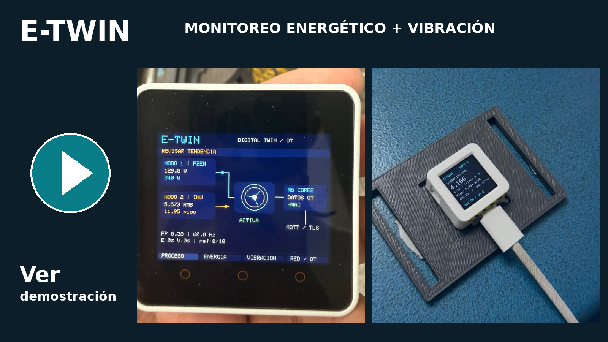
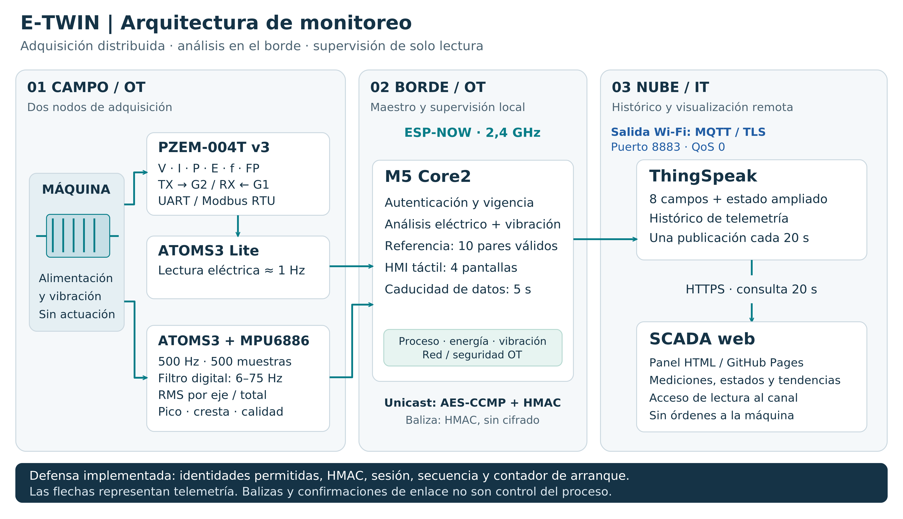

# E-TWIN · Monitoreo energético y vibracional

Prototipo IoT de **solo monitoreo** con dos nodos ESP-NOW, análisis local en M5 Core2 y SCADA web. Material preparado para la categoría **Industria 4.0, AIoT y Gemelos Digitales** del I Concurso Nacional IoT ULEAM 2026.

[](https://youtu.be/txEMzoSkKmY)

**Haz clic en la imagen para abrir el video.**

## Arquitectura



| Dispositivo | Función |
|---|---|
| ATOMS3 Lite + PZEM-004T v3 | Tensión, corriente, potencia activa, energía, frecuencia y factor de potencia. PZEM TX → G2; PZEM RX ← G1. |
| ATOMS3 + MPU6886 | Aceleración triaxial, 500 Hz nominales, ventanas de 500 muestras; filtro 6–75 Hz; RMS, pico y calidad. |
| M5 Core2 | Recepción autenticada, referencia de **10 pares**, cuatro vistas táctiles y publicación MQTT/TLS. |
| ThingSpeak + panel HTML | Ocho campos y estado ampliado; consulta HTTPS de solo lectura cada 20 s. |

La representación digital refleja telemetría: no estima RPM, eficiencia mecánica ni vida útil, y no gobierna actuadores.

## Artículo y resultados

**[Leer informe IEEE (PDF)](articulo/E_TWIN_Informe_IEEE_ULEAM_2026.pdf)** · [Fuentes LaTeX](articulo/main.tex) · [Datos seleccionados](data/ultimos_10_min_validos.csv) · [Resumen auditable](data/resumen.json)

Se analizaron **31 observaciones** del **23/10/2026, 16:40:37–16:50:37 (UTC−5)**: los extremos incluidos cubren 600 s y 30 intervalos de 20 s. La ventana se ancla a la última lectura conjunta válida; las filas posteriores incompletas no se convierten en ceros.

| Indicador observado | Resultado |
|---|---:|
| Potencia activa media | 341,15 W |
| Aceleración RMS media | 4,736 m/s² |
| Incremento de energía | 57,000 Wh |
| Integral trapezoidal de potencia | 56,778 Wh |
| Discrepancia interna de energía | 0,389 % |

**El 0,389 % no es un error de exactitud frente a un patrón.** Ambas magnitudes proceden del mismo PZEM. El [artículo de referencia de Varela-Aldás, Silva y Palacios-Navarro](https://doi.org/10.3390/en15186637) se utiliza como antecedente y guía de validación; sus errores experimentales no se atribuyen a este montaje. La evidencia inercial no incluye una calibración independiente.

## Preparar el firmware

Con Python y PlatformIO disponibles, desde esta raíz:

```bash
python tools/init_local.py
```

Edita `include/config.h` con tu Wi-Fi de 2,4 GHz, credenciales MQTT y parámetros de máquina. Las claves de radio se generan una sola vez para la instalación y deben ser las mismas al compilar los tres equipos. Los valores de tensión nominal y alarma absoluta de vibración están desactivados en el ejemplo; deben definirse según el activo y el procedimiento de puesta en marcha.

Conecta un equipo a la vez y ejecuta:

```bash
pio run -e master_core2 -t upload
pio run -e slave_energy -t upload
pio run -e slave_vibration -t upload
```

Los comandos se ejecutan desde la carpeta de **`platformio.ini`**, no desde `firmware/`. Para seleccionar puerto usa `pio device list` y `--upload-port COMx`. Mantén los límites eléctricos, el aislamiento y las protecciones requeridos por el PZEM y la instalación. El equipo no es un sistema de protección ni de seguridad funcional.

## Reproducir el análisis

```bash
python -m pip install -r analysis/requirements.txt
python analysis/analyze_csv.py
```

Se regeneran selección, auditoría, estadísticas, resumen JSON, tabla LaTeX y gráficas. El original no se modifica. Véase [metodología del análisis](analysis/README.md).

Para pruebas de anfitrión del firmware/filtro/panel, se requieren además un compilador C++17, bibliotecas de desarrollo OpenSSL y Node.js:

```bash
python tools/check_local.py
```

La evaluación registrada produjo 145 comprobaciones del núcleo sin fallos, además de pruebas del filtro y del panel aprobadas. **No equivale a compilar para ESP32 ni a una certificación de seguridad.** La inicialización local es necesaria antes de estas pruebas.

## Publicar el panel

`web/index.html` es una aplicación estática autónoma. El flujo de GitHub Pages incluido despliega **solo la carpeta `web/`**, no los archivos privados de firmware. En GitHub: **Settings → Pages → Source → GitHub Actions**. Al abrir el panel, selecciona **Conectar canal**, introduce el ID del canal (el del ensayo es `1309330`) y deja la clave de lectura vacía únicamente si el canal es público.

No se publica ni habilita automáticamente la visibilidad de un canal de ThingSpeak. Nunca introduzcas claves de escritura o credenciales MQTT en el HTML. Los datos industriales privados requieren control de acceso. Véase [publicación](docs/PUBLICACION.md).

## Estructura

```text
firmware/       Tres programas originales de V2
include/        Cabeceras y config.example.h sin secretos
web/            SCADA y material para ThingSpeak Plugins
articulo/       Informe PDF, LaTeX, bibliografía y figuras
analysis/       Procesamiento reproducible del CSV
data/           Original, selección, auditoría y resultados
assets/         Arquitectura y miniatura enlazada al video
docs/           Evidencias, procedencia y notas de entrega
tests/, tools/  Pruebas y preparación local
```

